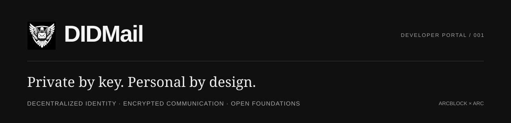

  <a href="https://didmail.org/">Website</a> ·
  <a href="https://didmail.org/#how">How it works</a> ·
  <a href="https://didmail.org/#technology">Technology</a> ·
  <a href="https://github.com/didmail-org/didmail-org.github.io">Website source</a>

**DIDMail is building decentralized email around private-key identities and end-to-end encrypted content.** NFT envelopes and namecards bring personal expression to communication; independently operated mail nodes provide delivery and encrypted storage.

### For developers

ArcBlock DID · Native ARC Blocklet / AFS / AUP · TypeScript · React Native · Flutter

Start with the [project overview](https://github.com/didmail-org/overview), [protocol](https://github.com/didmail-org/protocol) and [native Server](https://github.com/didmail-org/server). The [public website](https://github.com/didmail-org/didmail-org.github.io) has a buildless contribution path.

**In development.** Protocol, project guidance and Server source are public. Client publication and distribution reviews continue. Original code uses Apache-2.0; third-party licenses still apply. Production readiness and an independent security audit have not been established.

---

[English](https://didmail.org/?lang=en) · [中文](https://didmail.org/?lang=zh) · [日本語](https://didmail.org/?lang=ja) · [Русский](https://didmail.org/?lang=ru) · [العربية](https://didmail.org/?lang=ar)
